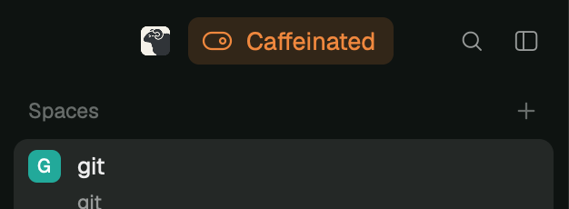

# herdr-espresso-switch

An Espresso switch for [Herdr](https://github.com/herdrdev/herdr-app): keep your Mac awake while your agents work. It runs on top of [espresso](https://github.com/Hanyang-Li/espresso).



It sits beside the Herdr logo at the top left of the sidebar and reads **Drink Espresso**. Click it and the Mac stops going to sleep; the button turns orange and reads **Caffeinated**. Click again and the Mac sleeps as usual. Search and the sidebar toggle stay where they were.

## Requirements

- Herdr 0.1.15 or newer, on an Apple Silicon Mac
- [espresso](https://github.com/Hanyang-Li/espresso), on your `PATH` or at `~/.local/bin/espresso`:

  ```sh
  curl -fsSL https://raw.githubusercontent.com/Hanyang-Li/espresso/main/install.sh | sh
  ```

- Optional, to stay awake with the lid closed: `sudo espresso daemon install`. Without it, closing the lid still puts the Mac to sleep.

## Install

Ask your agent to add `github.com/reeeeeee-dev/herdr-espresso-switch` to Herdr, or do it by hand:

1. Copy `mods/espresso-switch/` to `~/.config/herdr-app/mods/espresso-switch/`.
2. In your layout, point the sidebar's `brand` block at the mod. Shipped layouts are rewritten on start, so do this in your own (cloned) layout:

   ```json
   { "id": "brand", "type": "block", "content": { "mod": "espresso-switch" }, "size": { "px": 46 }, "window_drag": true }
   ```

3. `herdr-app check ~/.config/herdr-app/mods/espresso-switch`

## What it touches

- **Programs:** the mod runs `sh`, which starts or stops `espresso -- /bin/sh -c '<wait for espresso to end>'`. espresso keeps the Mac from idle sleep for as long as that command runs.
- **Files:** one file outside the mod's folder, `~/.config/herdr-app/espresso-switch.pid`, naming the process it started.
- **Network:** none.

## Good to know

- espresso prevents system sleep, not display sleep: the screen can still dim, turn off and lock while the Mac stays awake.
- The `espresso` process is detached, so the Mac stays awake after you close or quit Herdr. Switch it off before you leave, or run `kill $(cat ~/.config/herdr-app/espresso-switch.pid)`.
- The button only tracks the `espresso` it started. One started elsewhere does not turn the button on and is never killed by it.
- State is re-read every 30 seconds, so an `espresso` ended some other way shows as off within that time.
- If espresso is not installed the button stays off and its tooltip says so.
- Two constants at the top of `main.js`: `DIR` is the mod's folder (change it if you rename the folder, or the icons go missing), and `LOGO = false` leaves the Herdr logo out so the switch takes its place.
- The orange is fixed (`#f0883e`) and does not follow the theme.

`RECIPE.md` is the brief another agent can rebuild this mod from.
