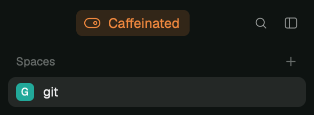

# Caffeinate

The top row of Herdr's sidebar with a Caffeinate button where the Herdr logo was. One click keeps the Mac awake and the button turns orange and reads "Caffeinated"; another click lets it sleep again. Search and the sidebar toggle sit to its right as before.

**What you see**

- **The row** (46px tall, the sidebar's `brand` block, full sidebar width): the theme's `chrome` background, 13.5px text, 14px padding on the left and 10px on the right, 4px gaps. On macOS, outside fullscreen, the left padding is 76px to clear the traffic lights.
- **Caffeinate button** (26px tall, left aligned, 6px corner radius, 7px left and 9px right padding, semibold): an 18px switch icon, a 7px gap, then the label.
  - Off: icon `toggle-left.svg` (knob on the left), label "Caffeinate", both in the theme's `dim` color, no fill. Hover: the theme's `hover` fill and `muted` text.
  - On: icon `toggle-right.svg` (knob on the right), label "Caffeinated", both `#f0883e`, on a `#f0883e29` fill. Hover: `#f0883e40`.
- **Search** and **sidebar toggle**: two 26px square buttons with 15px icons in the `muted` color, on the right. Hover: the `hover` fill and `foreground` color.
- **On the narrow sidebar rail** (sidebar under 160px wide): the Caffeinate button and search are hidden and the left padding is 6px. Off macOS the sidebar toggle remains; on macOS the row is empty, because the traffic lights fill it.

**How it behaves**

- Clicking the Caffeinate button flips it. On starts `/usr/bin/caffeinate -dims` detached and writes its pid to `<herdr-app home>/caffeinate.pid`; off kills that process and removes the file. The button redraws from what the script reports, not from the click.
- The tooltip reads "Caffeinate is on: this Mac stays awake" or "Caffeinate is off: this Mac sleeps as usual".
- State is read when the mod loads and every 30 seconds after, so a `caffeinate` that ended elsewhere shows as off.
- Only the process named in the pid file counts. A `caffeinate` started some other way does not turn the button on and is not killed by it. A stale pid (the process is gone, or the pid now belongs to another program) counts as off.
- The process outlives Herdr: quit Herdr with the button on and the Mac stays awake; the button is still on at the next start.
- Search opens the `picker` mod. The sidebar toggle narrows the sidebar to the rail (76px on macOS, 44px elsewhere), remembering its width, or restores it (268px if none was remembered).
- Clicks on the three buttons do not start a window drag; the rest of the row does.
- Agent status plays no part in this mod.

**Built from**

- `mods/caffeinate/main.js`: one `View`. `mod.json`: `{ "place": "none", "title": "Caffeinate" }` (plus `cloned_from` `workspace-chrome` 0.1.15, whose brand half this row replaces; the footer stays with the shipped `workspace-chrome`).
- Layout: the sidebar column's first block, `{ "id": "brand", "type": "block", "content": { "mod": "caffeinate" }, "size": { "px": 46 }, "window_drag": true }`.
- `gpui-kit`: `View`, `div`, `svg`; `gpui-base`: `h_flex`. `cx.timer.every(30000, ...)` for the re-read, `cx.spawn` around the `exec`, `cx.notify()` after it.
- `herdr` functions: `exec` (`sh -c <script> sh <pid file> <on|off|nothing>`), `appHome` (where the pid file goes), `theme`, `window` (`platform`, `fullscreen`), `layout` (the `sidebar` node's `size.px`), `shared` / `setShared` (`sidebar.width`, `sidebar.collapsed`), `run` (`mod.open {name: "picker"}`, `layout.resize {id: "sidebar", px}`).
- The script, one for reading and flipping: read the pid from the file; "alive" means `ps -p <pid> -o comm=` ends in `caffeinate`; `on` starts `nohup /usr/bin/caffeinate -dims </dev/null >/dev/null 2>&1 &` and writes `$!` unless alive; `off` kills it if alive and removes the file; it ends by printing `on` or `off`.
- Art: `toggle-left.svg`, `toggle-right.svg`, `search.svg`, `sidebar.svg`: 24px stroke icons, 1.5 stroke width, `currentColor`.

**Watch out**

- macOS only: `/usr/bin/caffeinate` does not exist elsewhere.
- Start the process with `nohup` and all three streams redirected, or `exec` waits for it and the button never updates.
- Check the pid's command name, not only that the pid exists: pids are reused.
- `herdr-app check` runs the mod's `exec` for real. With no third argument the script only reads state, so a check never flips it.
- Themes name no orange, so the on color is fixed at `#f0883e` and does not change with the theme.
- Icon paths are from the herdr-app home (`mods/caffeinate/toggle-left.svg`); rename the folder and they must change too.
- Whether the sidebar is the rail goes by its width (under 160px), not by a flag, because dragging its edge narrows it too. `sidebar.collapsed` is still set for mods that read it.
- Shipped layouts and mods are rewritten on every start: put the block in your own layout and keep this mod in its own folder.
- Built against Herdr 0.1.15 on macOS.

**Done when**

- `herdr-app check mods/caffeinate` passes and `herdr-app status` shows no errors.
- With the button off, `caffeinate.pid` is absent. Clicking it makes the button orange and "Caffeinated", and `ps -p $(cat ~/.config/herdr-app/caffeinate.pid) -o comm=` prints `/usr/bin/caffeinate`.
- Clicking again kills that process, removes the file, and the button reads "Caffeinate" in the dim color.
- Killing the process by hand turns the button off within 30 seconds.
- A `caffeinate` started in a terminal leaves the button off, and switching the button on and off leaves that process running.
- Search opens the picker; the sidebar toggle goes to the rail and back to the previous width.
